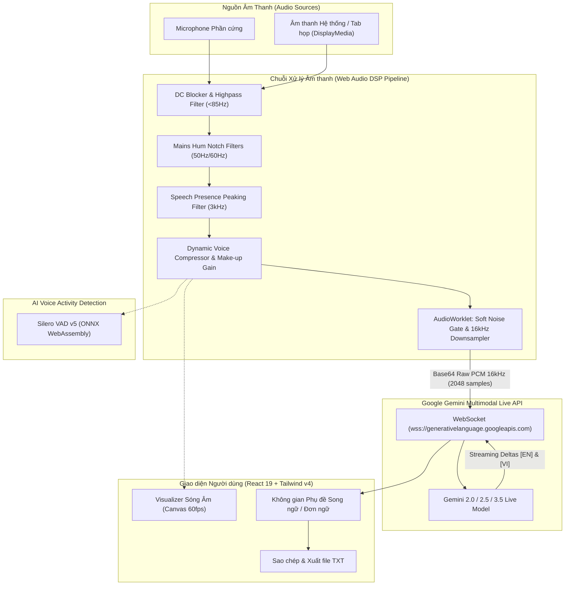

# LiveTranslate (LinguaLive) 🌐⚡

> **Ứng dụng dịch phụ đề trực tiếp & giọng nói thời gian thực với độ trễ cực thấp (Ultra-low Latency Real-time Live Translation)** sử dụng công nghệ **Google Gemini Multimodal Live API**, chuỗi xử lý tín hiệu âm thanh chuyên sâu **Web Audio DSP Pipeline** và mô hình nhận diện giọng nói **Silero VAD v5**.

[](./LICENSE)
[](https://react.dev/)
[](https://www.typescriptlang.org/)
[](https://vitejs.dev/)
[](https://tailwindcss.com/)
[](https://ai.google.dev/)
[](https://onnxruntime.ai/)

---

## 📖 Mục lục

- [Giới thiệu](#-giới-thiệu)
- [Điểm mạnh vượt trội so với các repo khác](#-điểm-mạnh-vượt-trội-so-với-các-repo-khác-why-livetranslate)
- [Tính năng nổi bật](#-tính-năng-nổi-bật)
- [Kiến trúc hệ thống & Luồng dữ liệu](#-kiến-trúc-hệ-thống--luồng-dữ-liệu)
- [Cấu trúc mã nguồn](#-cấu-trúc-mã-nguồn)
- [Yêu cầu hệ thống](#-yêu-cầu-hệ-thống)
- [Hướng dẫn cài đặt & Khởi chạy](#-hướng-dẫn-cài-đặt--khởi-chạy)
- [Hướng dẫn sử dụng & Cấu hình](#-hướng-dẫn-sử-dụng--cấu-hình)
- [Bảo mật & Quyền riêng tư](#-bảo-mật--quyền-riêng-tư)
- [Giấy phép (License)](#-giấy-phép-license)
- [Tác giả](#-tác-giả)

---

## 🌟 Giới thiệu

**LiveTranslate (LinguaLive)** là giải pháp phần mềm webclient chạy trực tiếp trên trình duyệt, biến máy tính của bạn thành một trạm phiên dịch hội nghị trực tiếp chuyên nghiệp. 

Ứng dụng cho phép bạn:
- Thu âm trực tiếp từ **Microphone** hoặc **Âm thanh hệ thống/tab cuộc họp** (Google Meet, Zoom, Microsoft Teams, YouTube Livestream...).
- Xử lý và lọc nhiễu âm thanh theo thời gian thực (DSP Audio Pipeline) đạt chuẩn PCM 16kHz mono.
- Truyền phát liên tục (streaming) qua kết nối **WebSocket hai chiều** đến **Google Gemini Live API**.
- Nhận và hiển thị phụ đề dịch nghĩa tiếng Việt (hoặc song ngữ Anh - Việt) theo từng âm tiết mượt mà với độ trễ cực thấp.

Dự án được xây dựng phục vụ các cuộc họp quốc tế, học tập ngoại ngữ, hội thảo trực tuyến, xem livestream hoặc chuyển đổi giọng nói thành văn bản tức thời.

---

## 🏆 Điểm mạnh vượt trội so với các repo khác (Why LiveTranslate?)

Hiện nay trên thị trường mã nguồn mở có nhiều repo hỗ trợ dịch giọng nói (Speech-to-Text / Translate), nhưng hầu hết đều gặp các rào cản lớn về tài nguyên phần cứng, chi phí hoặc độ trễ. Dưới đây là những điểm vượt trội của **LiveTranslate**:

| Tiêu chí so sánh | LiveTranslate (Dự án này) | Các repo chạy Local (Whisper / Seamless / Ollama) | Các giải pháp gọi HTTP REST API truyền thống |
| :--- | :--- | :--- | :--- |
| **Chi phí API / Server** | 🟢 **Hoàn toàn Miễn phí** (Dùng Gemini Live Free API Key) | 🔴 Tốn kém mua GPU đắt tiền hoặc thuê Cloud GPU (100$-300$/tháng) | 🔴 Trả tiền theo từng phút audio của OpenAI / Google Cloud |
| **Yêu cầu Phần cứng** | 🟢 **Không cần máy mạnh** (Laptop văn phòng, MacBook Air, Mini PC đều mượt) | 🔴 Đòi hỏi GPU NVIDIA 8GB - 24GB VRAM, CPU ngốn 100%, quạt rú to | 🟡 Phụ thuộc vào tốc độ máy chủ backend trung gian |
| **Cài đặt & Setup** | 🟢 **Siêu nhanh (~30 giây)**: Chỉ cần `npm install` & `npm run dev` | 🔴 Cực kỳ phức tạp (Cài Python, CUDA, PyTorch, C++ Build Tools, Docker vài chục GB) | 🔴 Phải dựng Backend trung gian (FastAPI, Express, Celery, Redis...) |
| **Độ trễ xử lý (Latency)** | 🟢 **Dưới 1 giây (Sub-second)** nhờ WebSocket Streaming 2 chiều liên tục | 🟡 2 - 5 giây tùy công suất GPU cục bộ | 🔴 4 - 8 giây (Do phải thu gom chunk 3-5s rồi mới gửi REST request) |
| **Lọc nhiễu & VAD** | 🟢 **Tích hợp sẵn DSP AudioWorklet + Silero VAD v5** trên WebAssembly | 🟡 Thường chỉ nhận diện voice thô, dễ bắt nhầm tiếng gõ phím / thở | 🔴 Không có lọc âm phía client, dễ dịch sai khi môi trường ồn |
| **Khả năng triển khai** | 🟢 **Pure Client-Side**: Triển khai 1-click lên Vercel, Netlify, GitLab Pages | 🔴 Phải có dedicated server/VPS có card đồ họa | 🔴 Phải duy trì hạ tầng server backend liên tục |

### Chi tiết các ưu điểm nổi bật:

1. **Sử dụng Gemini Live API Key Miễn phí (Zero Cloud Cost):**
   - Bạn chỉ cần lấy API Key miễn phí từ [Google AI Studio](https://aistudio.google.com/).
   - Tận dụng sức mạnh của các mô hình đa phương thức hàng đầu hiện nay (`gemini-2.0-flash-exp`, `gemini-2.5-flash`, `gemini-3.5-preview`) với hạn mức miễn phí dồi dào, không lo hết credit hay hóa đơn phát sinh.

2. **Cực kỳ nhẹ & Thân thiện với mọi cấu hình máy tính (No GPU Required):**
   - Không còn nỗi lo máy tính đơ giật, lag hình trong lúc họp online do chạy các mô hình AI nặng nề trên máy.
   - Toàn bộ tác vụ suy luận AI được Google xử lý trên hạ tầng đám mây. Trên máy bạn, ứng dụng chỉ tiêu tốn một lượng nhỏ RAM/CPU cho trình duyệt, giữ cho máy luôn mát mẻ và mượt mà.

3. **Cài đặt và chạy trong 30 giây (Zero-Backend Setup):**
   - Không cần thiết lập môi trường máy học cồng kềnh (không cần Python, CUDA, C++, ffmpeg).
   - Mã nguồn 100% TypeScript/React thuần khiết phía client. Chỉ cần clone về là có thể chạy ngay trên trình duyệt hoặc host tĩnh mọi nơi.

4. **Trải nghiệm Streaming tức thời thay vì "Cắt lát âm thanh" (Chunking):**
   - Thay vì phải chờ người nói dứt câu 3-5 giây rồi mới gửi file âm thanh, giao thức WebSocket hai chiều của LiveTranslate truyền nhận liên tục từng frame âm thanh 16kHz thô. Phụ đề hiển thị theo thời gian thực gần như song song với lời nói.

5. **Bộ lọc khử ồn chuyên nghiệp ngay trên trình duyệt:**
   - Kết hợp giữa **Web Audio DSP** (cắt âm ù rền, khử nhiễu điện 50/60Hz, nén giọng) và **Silero VAD v5 Deep Learning** (lọc tiếng gõ bàn phím, tiếng ho, tiếng thở) giúp Gemini nhận được tín hiệu âm thanh sạch nhất, tăng tối đa độ chính xác của bản dịch.

6. **Giấy phép Apache 2.0 tự do & rộng mở:**
   - Dự án mở mã nguồn với giấy phép **Apache License 2.0**, cho phép cá nhân, trường học, tổ chức hay doanh nghiệp thoải mái sử dụng, mở rộng, tích hợp và thương mại hóa mà không có bất kỳ ràng buộc ngặt nghèo nào.

---

## 🚀 Tính năng nổi bật

### 1. Kết nối Google Gemini Multimodal Live API (WebSocket)
- **Truyền nhận hai chiều siêu tốc (Bidirectional Streaming):** Kết nối trực tiếp qua `wss://generativelanguage.googleapis.com/ws/google.ai.generativelanguage.v1alpha.GenerativeService.BidiGenerateContent`.
- **Hỗ trợ các model thế hệ mới:** Tương thích với `gemini-2.0-flash-exp`, `gemini-2.5-flash-native-audio-preview`, `gemini-3.5-live-translate-preview`.
- **Streaming Text Deltas:** Hiển thị tức thì từng từ vựng khi AI đang suy nghĩ và dịch, tạo cảm giác mượt mà tự nhiên như phụ đề truyền hình trực tiếp.
- **Tự động kết nối lại (Auto-reconnect):** Cơ chế tự động hồi phục phiên khi rớt mạng hoặc ngắt kết nối WebSocket đột ngột.

### 2. Chuỗi xử lý âm thanh DSP chuyên sâu (Web Audio DSP Pipeline)
- **AudioWorklet (`PcmCaptureProcessor`):** Thu âm và chuyển đổi tần số lấy mẫu (downsample) sang chuẩn 16kHz Mono trên luồng audio chuyên biệt, **hoàn toàn không gây giật lag luồng render giao diện (đảm bảo 60 FPS)**.
- **DC-Blocker Filter:** Tự động loại bỏ hiện tượng lệch điện áp một chiều (DC bias) thường gặp trên các dòng micro phổ thông.
- **Adaptive Soft Noise Gate:** Cổng khử nhiễu thích ứng 4 cấp độ (*Tắt, Thấp, Trung bình, Cao*) với cơ chế mở mượt (Attack ~5ms) và nhả êm (Release ~150ms), giúp loại bỏ tiếng xì nền/tiếng quạt gió mà không nuốt mất âm gió, âm đuôi của từ ngữ.
- **Audio Enhancer Chain:**
  - *Sub-bass Highpass Filter (< 85Hz):* Triệt tiêu tiếng va đập mặt bàn, tiếng gió micro.
  - *Dual Mains Hum Notch Filters (50Hz & 60Hz):* Lọc triệt để tiếng rè tần số điện lưới.
  - *High-Frequency Lowpass Filter (> 7.5kHz):* Cắt bỏ tạp âm tần số cao, chống hiện tượng méo tiếng aliasing khi chuyển về 16kHz.
  - *Speech Presence Boost (2.8kHz - 3.2kHz):* Tăng cường formant giọng nói, giúp AI nhận diện rõ ràng từng phụ âm.
  - *Dynamic Voice Compressor:* Tự động cân bằng âm lượng (levelling), chống vỡ tiếng khi nói lớn và bù gain khi nói nhỏ/thì thầm.

### 3. Nhận diện giọng nói AI Silero VAD v5 (Voice Activity Detection)
- Tích hợp mô hình Deep Learning **Silero VAD v5** chạy trực tiếp bằng **ONNX Runtime WebAssembly** ngay trên trình duyệt.
- Phân biệt chính xác giọng nói người thật với tiếng thở, tiếng cạch cạch của bàn phím, tiếng ho, cười hoặc tạp âm môi trường.
- Đèn báo trạng thái trực quan trên thanh Header (*Đang nói (Silero VAD)* vs *Đang nghe & dịch*).

### 4. Thu âm linh hoạt đa nguồn (Dual Audio Input Sources)
- **Microphone:** Tự động quét và cho phép lựa chọn cụ thể micro phần cứng trong danh sách thiết bị kết nối.
- **Âm thanh Hệ thống / Tab họp (System & Tab Audio):** Dễ dàng thu âm thanh từ tab trình duyệt hoặc ứng dụng hội nghị trực tuyến (Zoom, Google Meet, MS Teams, YouTube...) thông qua cơ chế Screen/Tab Audio Capture.

### 5. Trải nghiệm không gian phụ đề (Subtitle Workspace)
- **2 Chế độ hiển thị:**
  - *Chỉ tiếng Việt (`vi_only`):* Tối giản, tập trung vào bản dịch.
  - *Song ngữ (`bilingual`):* Hiển thị song song bản gốc tiếng Anh (`[EN]`) và bản dịch tiếng Việt (`[VI]`).
- **Phát hiện ngắt quãng & Tự động chèn Pause Marker:** Tự động tạo mốc ngắt phân đoạn khi diễn giả ngừng phát biểu trên 12 giây.
- **Bộ lọc từ đệm thông minh (Smart Filler-words Filter):** Tự động loại bỏ tiếng ậm ừ ("um", "uh", "à", "ừm", v.v.) và rút gọn từ nối dư thừa.
- **Từ điển chuyên ngành tùy chỉnh (Custom Glossary):** Cung cấp prompt hướng dẫn Gemini nhận diện chính xác các thuật ngữ công nghệ, tên riêng của doanh nghiệp.
- **Tối ưu hóa DOM (DOM Virtualization Limit):** Giới hạn hiển thị 80 phân đoạn gần nhất trên màn hình, giúp ứng dụng duy trì tốc độ mượt mà ngay cả trong các buổi họp kéo dài nhiều tiếng đồng hồ.
- **Sao chép & Xuất dữ liệu:** Sao chép nhanh từng câu hoặc toàn bộ biên bản cuộc họp; hỗ trợ xuất file phụ đề `.txt` kèm mốc thời gian (timestamps).

### 6. Giao diện trực quan & Cá nhân hóa
- **Giao diện hiện đại:** Hỗ trợ Dark Mode & Light Mode sang trọng, hiển thị biểu đồ sóng âm thanh trực tiếp (Audio Visualizer).
- **Cá nhân hóa:** Tùy biến cỡ chữ (từ `sm` đến `2xl`), khoảng cách dòng, độ rộng khung hình, chế độ Toàn màn hình (Fullscreen).
- **Chế độ Demo Simulator:** Trải nghiệm ngay lập tức tính năng dịch mô phỏng mà không cần nhập Google Gemini API Key.

---

## 🏗 Kiến trúc hệ thống & Luồng dữ liệu



---

## 📁 Cấu trúc mã nguồn

```text
live_translate/
├── public/                 # Tệp tĩnh công khai
├── src/
│   ├── assets/             # Hình ảnh & icons
│   ├── components/         # Các thành phần giao diện React
│   │   ├── AudioVisualizer.tsx    # Hiển thị visualizer sóng âm theo thời gian thực
│   │   ├── BottomDock.tsx         # Thanh điều khiển trung tâm (Micro, Tab, Play/Pause, Cài đặt)
│   │   ├── Header.tsx             # Thanh tiêu đề, trạng thái kết nối, VAD, Theme & Fullscreen
│   │   ├── LanguageBar.tsx        # Thanh thông tin ngôn ngữ nguồn & đích
│   │   ├── SettingsModal.tsx      # Hộp thoại cài đặt API Key, Model, DSP, VAD, giao diện
│   │   └── SubtitleWorkspace.tsx  # Khu vực hiển thị phụ đề trực tiếp & công cụ xuất
│   ├── hooks/
│   │   └── useSmoothText.ts       # Hook làm mượt hiệu ứng streaming text theo âm tiết
│   ├── services/           # Xử lý logic tầng dịch vụ (Core Services)
│   │   ├── audioEnhancer.ts       # Bộ lọc DSP (Highpass, Notch, Peaking, Dynamics Compressor)
│   │   ├── audioStreamer.ts       # AudioWorklet Processor, Noise Gate, Downsample 16kHz
│   │   ├── demoSimulator.ts       # Trình giả lập dịch trực tiếp cho chế độ Demo
│   │   ├── geminiLiveClient.ts    # WebSocket client kết nối Gemini Multimodal Live API
│   │   └── vadService.ts          # Tích hợp Silero VAD qua ONNX Runtime WebAssembly
│   ├── types/
│   │   └── index.ts               # Định nghĩa TypeScript interfaces & cấu hình mặc định
│   ├── utils/
│   │   └── textFilter.ts          # Bộ lọc từ đệm (filler-words), ghép nối text stream
│   ├── App.tsx             # Component gốc kết nối luồng trạng thái
│   ├── main.tsx            # Điểm khởi đầu React
│   └── index.css           # Cấu hình Tailwind CSS v4
├── LICENSE                 # Giấy phép mã nguồn mở Apache License 2.0
├── package.json            # Thông tin dependencies và scripts
├── tsconfig.json           # Cấu hình TypeScript
└── vite.config.ts          # Cấu hình Vite bundler
```

---

## 💻 Yêu cầu hệ thống

- **Node.js:** Phiên bản `>= 18.0.0` (khuyến nghị phiên bản LTS mới nhất).
- **Trình quản lý gói:** `npm`, `yarn`, `pnpm` hoặc `bun`.
- **Trình duyệt web hỗ trợ:**
  - Google Chrome (phiên bản 90+) *(Khuyến nghị để có trải nghiệm Web Audio & WebSockets tối ưu nhất)*
  - Microsoft Edge (phiên bản 90+)
  - Brave / Opera / Chromium-based browsers
  - Hỗ trợ các chuẩn Web API: `AudioContext`, `AudioWorklet`, `MediaDevices`, `WebSocket`, `WebAssembly`.

---

## 🛠 Hướng dẫn cài đặt & Khởi chạy

### 1. Sao chép kho mã nguồn (Clone repository)

```bash
git clone https://gitlab.com/<username>/live_translate.git
cd live_translate
```

### 2. Cài đặt các thư viện phụ thuộc (Dependencies)

```bash
npm install
```

### 3. Khởi chạy môi trường phát triển (Development)

```bash
npm run dev
```

Sau khi chạy lệnh trên, ứng dụng sẽ hoạt động tại địa chỉ: `http://localhost:5173`. Mở đường dẫn này trên trình duyệt Chrome hoặc Edge.

### 4. Kiểm tra mã nguồn (Linting)

```bash
npm run lint
```

### 5. Đóng gói bản phát hành (Production Build)

```bash
npm run build
```

Thư mục tĩnh `dist/` sẽ được tạo ra, sẵn sàng để triển khai lên Vercel, Netlify, GitLab Pages hoặc bất kỳ máy chủ Web (Nginx/Apache) nào.

---

## ⚙️ Hướng dẫn sử dụng & Cấu hình

### Lấy Google Gemini API Key

1. Truy cập [Google AI Studio](https://aistudio.google.com/).
2. Đăng nhập bằng tài khoản Google và nhấn **Get API key**.
3. Tạo mới một API Key và sao chép mã khóa.

### Thiết lập trong ứng dụng

1. Trên giao diện **LiveTranslate**, nhấn vào biểu tượng **Cài đặt (Bánh răng)** ở góc trên bên phải.
2. Dán mã khóa vào ô **Gemini API Key**.
3. Nhấn **Kiểm tra** để hệ thống xác thực tính hợp lệ của key với Google.
4. Tùy chỉnh các thông số bổ sung nếu cần:
   - **Mô hình AI:** Chọn model hỗ trợ Live WebSocket (mặc định: `models/gemini-3.5-live-translate-preview` hoặc `gemini-2.0-flash-exp`).
   - **DSP Khử nhiễu:** Bật/tắt cổng khử nhiễu (Noise Gate: Thấp / Vừa / Cao), Dynamic Compressor, Speech Clarity Boost.
   - **Silero VAD:** Bật tính năng nhận diện giọng nói AI để lọc bỏ tiếng ồn môi trường.
   - **Từ điển chuyên ngành (Glossary):** Nhập các từ khóa chuyên ngành để Gemini dịch chuẩn xác hơn.
5. Nhấn **Lưu cài đặt**.

### Bắt đầu phiên dịch

- **Để dịch giọng nói của bạn:** Chọn nguồn **Micro**, sau đó bấm **Bắt đầu**.
- **Để dịch cuộc họp / Video YouTube:** Chọn nguồn **Âm thanh họp/tab**, cấp quyền chia sẻ tab có âm thanh và bấm **Bắt đầu**.
- **Chế độ Demo:** Nếu chưa có API Key, nhấn nút **Chế độ Demo** trên thanh Header để trải nghiệm các tính năng phụ đề mô phỏng.

---

## 🔒 Bảo mật & Quyền riêng tư

- **Không có máy chủ trung gian (Zero Intermediate Server):** Ứng dụng chạy hoàn toàn ở phía client (trình duyệt). Không có bất kỳ máy chủ bên thứ ba nào thu thập dữ liệu giọng nói hay văn bản của bạn.
- **Bảo mật API Key:** Mã Gemini API Key được lưu trữ cục bộ trong `localStorage` trên trình duyệt của riêng bạn.
- **Mã hóa đầu cuối kết nối:** Luồng âm thanh và phụ đề được truyền phát qua kết nối WebSocket bảo mật (`wss://`) trực tiếp tới hạ tầng Google Cloud.

---

## 📄 Giấy phép (License)

Dự án này được cấp phép theo giấy phép mã nguồn mở **[Apache License 2.0](./LICENSE)**.

```
Copyright 2026 LinhNH2003

Licensed under the Apache License, Version 2.0 (the "License");
you may not use this file except in compliance with the License.
You may obtain a copy of the License at

    http://www.apache.org/licenses/LICENSE-2.0

Unless required by applicable law or agreed to in writing, software
distributed under the License is distributed on an "AS IS" BASIS,
WITHOUT WARRANTIES OR CONDITIONS OF ANY KIND, either express or implied.
See the License for the specific language governing permissions and
limitations under the License.
```

Bất kỳ ai (cá nhân hoặc doanh nghiệp) đều có thể tự do sao chép, sửa đổi, phân phối, cấp phép lại và sử dụng phần mềm này cho cả mục đích phi thương mại lẫn thương mại.

---

## 👤 Tác giả

- **Tác giả:** LinhNH2003
- **Email:** [nguyenhoailinhenhoailinh852003@gmail.com](mailto:nguyenhoailinhenhoailinh852003@gmail.com)
- **Dự án:** [LiveTranslate (LinguaLive)](file:///d:/AI_project/live_translate)
